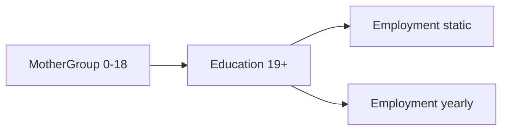

# Jacardi_Belgium

**Author:** Mahima Ghosh

Country pack for JACARDI Belgium (ISO3 `BEL`). Horizon: **2025–2055**.

Differs from Slovenia: **8** education levels (ISCED 4 exists); start education from **equations**
(`education_static_coefs.csv` + knots), not a lookup table; mother-group tables; employment
static knots + pension step; employment **yearly** package on disk.

## Files

| File | Role |
| --- | --- |
| `config.json` | Host; `risk_factors` levels = ladder order |
| `jacardi_model.json` | Init — education equations + mother start + employment static |
| `jacardi_model_update.json` | Update — education Part B / mother tables + employment yearly slots |
| `education_static_coefs.csv` / `education_static_knots.csv` | Part A SCORE (ages 19+) |
| `education_draw_at_19_ssp2.csv` | Part B age 19 (no mother group) |
| `education_upgrade_transitions_ssp2.csv` | Part B upgrades ages 20–30 (and 26–30 with mother) |
| `mother_group_start_2025.csv` | Start-year mother group ages 0–18 |
| `mother_group_newborn_by_year_ssp2.csv` | Births mother group |
| `education_draw_at_19_by_mother_ssp2.csv` | Part B age 19 when mother group present |
| `education_upgrade_transitions_by_mother_ssp2.csv` | Part B upgrades ages 20–25 by mother group |
| `employment_static_coefs.csv` / `employment_static_knots.csv` | Static SCORE |
| `employment_pension_step_ages.csv` | `PensionStep` ages (BE: female/male 65) |
| `employment_4cat_recode.csv` | Map employment_id 1–6 → employment4_id 1–4 |
| `employment_yearly_*.csv` / `employment_education_map.csv` / `employment_start_duration_shares.csv` / `statutory_retirement_by_year.csv` | Yearly employment (replaces hold) |
| `Belgium.DataFile.csv` | Dataset stub — **add when available** |

Templates: [`../Jacardi_Template/`](../Jacardi_Template/).

## Ladder → where it lives

| Level | Variable | Init | Update |
| --- | --- | --- | --- |
| 0 | Age, Sex | UNDB / DemographicModule | ageing |
| 1 | MotherGroup (1–3) | `mother_group_start_2025.csv` | newborns; kept for life |
| 1 | Education (1–8) | static coefs + knots | draw19 / upgrades (+ by_mother when group present) |
| 2 | EmploymentDetailed (1–6) + Employment (1–4) | static coefs + knots + pension step + recode | first draw at 19 (static); else yearly package |
| 3–6 | HLS … SBP | `*_coefs.csv` slots | `*_update_coefs.csv` slots |
| 7 | MI | `running.diseases` + datastore RRs | DiseaseModule |

Education / mother / employment CSVs listed above are on disk. HLS…SBP coef CSVs are named in JSON and arrive later.

## vs Slovenia

| Topic | Slovenia | Belgium |
| --- | --- | --- |
| Education IDs | 1–7 (no ISCED 4) | **1–8** (ISCED 4 = 4) |
| Start education | `education_lookup.csv` | **equations** + knots |
| Mother group | add to SI pack when ready | **in this pack** |
| Emp static knots / pension step | hard-coded / none | **knots file** + **pension step** |
| Emp Part B | temporary hold (until yearly wired) | yearly CSVs **in pack** (engine wiring later) |
| Upgrades | 20–30 | 20–30 |

## Factors mean / SES

Same as Slovenia: `adjust_to_factors_mean: false` — omit `baseline_adjustments.file_names`. Omit `modelling.ses_model`.

## Not fully runnable yet

- No `Belgium.DataFile.csv` in this folder yet (JSON name reserved).
- Pack JSON slots for mother, education equations, knots, pension step, and yearly employment are **ahead of** current Health-GPS schemas/loaders (SI still uses lookup + static hold). Engine/schema catch-up is a separate step.
- `*_check*.csv` golden files are not in this pack (keep local / tests only).

**Author:** Mahima Ghosh
