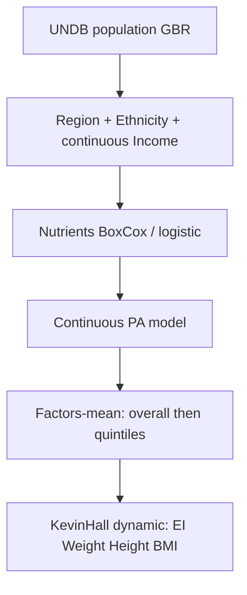

# KevinHall_FINCH

**Author:** Mahima Ghosh

Example pack for the **FINCH** (UK / GBR) Kevin Hall pathway in Health-GPS: continuous income, region and ethnicity, continuous physical activity, rich nutrient ladder, factors-mean calibration (overall + income quintiles), and Kevin Hall dynamics for energy / weight / height.

## Which config to use

**Use** `new_config.json`**.**

| File | Use? |
| --- | --- |
| `new_config.json` | **Yes — default host for current Health-GPS** (`project_requirements`, quintile adjustment, `new_static_model.json`) |
| `config.json` | Legacy / older layout — do not use for new runs |
| `new_JSON/` | Older snapshot of host + models — ignore for day-to-day runs |

Example:

```bash
HealthGPS.Console.exe -c /c/healthgps-examples/KevinHall_FINCH/new_config.json -T4
```

## What this pack does



1. Build a virtual UK population from the FINCH datastore zip (`data.source` in `new_config.json`).
2. Assign **region**, **ethnicity**, and **continuous income** (regression → then final categories `"4"`).
3. Draw **nutrients** / foods from StaticLinear (Box-Cox / optional logistic stage).
4. Draw **continuous physical activity**.
5. **Baseline adjust** income to overall factors-mean, then nutrients + PA **within income quintiles**.
6. Each year, **KevinHall** updates energy intake, weight, height, BMI.
7. Optional **policy scenarios** S1–S7 (policy-effect + residual covariance CSVs) when wired in interventions.
8. Optional **individual ID tracking** block in `new_config.json` for selected ages / regions / ethnicities.

Engine docs: [FINCH linear models guide](https://github.com/imperialCHEPI/healthgps/blob/main/documentation/technical/guides/finch-linear-models-and-income-adjustment.md) in the Health-GPS repo.

## Files

| File | Role |
| --- | --- |
| `new_config.json` | **Host config to run** — country, ladder, `project_requirements`, models, diseases, output |
| `new_static_model.json` | StaticLinear init (region, ethnicity, income, PA, nutrients, correlation, …) |
| `dynamic_model.json` | KevinHall dynamic model |
| `Finch.DataFile.csv` | Survey / microdata for visual validation |
| `Finch.FactorsMean.Male.csv` / `Female.csv` | Overall factors-mean by sex |
| `Finch.FactorsMean.*.Quintile1..5.csv` | Income-stratum factors-mean (adjustment only) |
| `income_model.csv` | Continuous income regression |
| `physicalactivity_model.csv` | Continuous PA regression |
| `region.csv` / `ethnicity.csv` | Demographic assignment tables |
| `boxcox_coefficients.csv` / `logistic_regression.csv` | Nutrient transforms |
| `Finch_residual_risk_factor_correlation.csv` | Residual correlation |
| `height_male.csv` / `height_female.csv` | Height by age (and related) |
| `weight_quantiles_NCDRisk_*.csv` | Weight quantiles (overall + by quintile) |
| `energy_physicalactivity_quantiles.csv` | Energy / PA quantiles |
| `ranges_riskfactors.csv` | Risk-factor ranges |
| `S1_…` … `S7_…` `policyeffect_model.csv` + `*_residual_policy_covariance.csv` | Policy scenario packs |
| `config.json` / `static_model.json` / `new_JSON/` | Legacy — not the primary run path |

## Ladder → where it lives

| Level | Variable | Init | Update |
| --- | --- | --- | --- |
| 0 | Age, Sex | UNDB / DemographicModule | ageing |
| 0 | Region, Ethnicity | `region.csv`, `ethnicity.csv` via StaticLinear | held / as coded |
| 0 | Income (continuous) + `income_category` | `income_model.csv` → categories `"4"` | trend off in `new_config` |
| 1 | Nutrients / foods | StaticLinear nutrient models + BoxCox / logistic | KevinHall / static rules as configured |
| 2 | PhysicalActivity, EnergyIntake | continuous PA model + energy pathway | KevinHall |
| 3 | Weight, Height, BMI | height CSVs + weight quantiles + KH maths | KevinHall |

## `project_requirements` (from `new_config.json`)

| Block | Setting |
| --- | --- |
| Demographics | region + ethnicity **on**; `gender2: female`; age cap 80 for linear models |
| Income | **enabled**, **continuous**, categories `"4"`, factors-mean adjust **on**, trended **off**, income CSV output **on** |
| Physical activity | **enabled**, **continuous**, factors-mean **on**, trended **off** |
| Risk factors | factors-mean **on**, trended **on** |
| Trend | **off** (`null`) |
| Two-stage | logistic **off** |

## Factors mean (baseline_adjustments)

FINCH **does** calibrate to population means:

1. Overall male/female tables adjust **income**.
2. People are ranked by continuous income into **5 quintiles** (`income_stratum_factors_mean`).
3. Nutrients + PA are adjusted **inside each quintile** using that quintile’s male/female CSV.
4. Final reporting categories still follow `income.categories` (`"4"`) — do not confuse with the 5 adjustment strata.

## Horizon / diseases

- Years in `new_config.json`: **2022–2027** (adjust as needed).
- Datastore: `finch-v4` zip URL + checksum in `new_config.json`.
- Disease list and intervention stub are in `running` of `new_config.json`.

## vs India pack

| Topic                 | FINCH (`KevinHall_FINCH`) | India (`KevinHall_India`)           |
| --------------------- | ------------------------- | ----------------------------------- |
| Host file             | `new_config.json`         | `config.json`                       |
| Country               | GBR                       | IND                                 |
| Income                | continuous → categories   | categorical logits (3)              |
| Region / ethnicity    | yes                       | no                                  |
| PA                    | continuous model          | simple (log-normal from mean)       |
| Quintile factors-mean | yes (5 strata)            | overall only                        |
| Trend                 | off in new_config         | income / UPF-style in India configs |

**Author:** Mahima Ghosh
