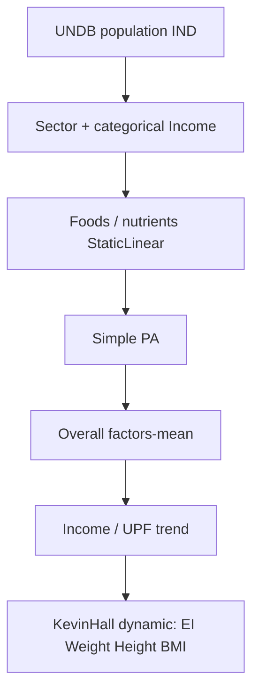

# KevinHall_India

**Author:** Mahima Ghosh

Example pack for the **India** Kevin Hall pathway in Health-GPS: categorical income (3 groups), rural/urban **sector**, simple physical activity, a shorter nutrient ladder (carb / fat / protein / sodium + food mirrors), overall factors-mean calibration, income/UPF-style trends, and Kevin Hall dynamics for energy / weight / height. Intervention scenario folders (subsidy / reformulation / cess) sit beside the baseline models.

## Which config to use

**Use** `config.json`**.**

| File | Use? |
| --- | --- |
| `config.json` | **Yes — default host for current India runs** |
| `new_config.json` | Alternate / experimental host with `project_requirements` — not the primary path for this pack |

Example:

```bash
HealthGPS.Console.exe -c /c/healthgps-examples/KevinHall_India/config.json -T4
```

## What this pack does



1. Build a virtual India population from the India datastore zip (`data.source` in `config.json`).
2. Assign **sector** (rural/urban) and **categorical income** (Low / Middle / High logits in StaticLinear).
3. Draw **food / nutrient** risk factors from StaticLinear regressions.
4. Draw **simple physical activity** (mean + std-dev style, not the FINCH continuous PA regression).
5. **Baseline adjust** risk factors to overall male/female factors-mean (no income-quintile stratum tables).
6. Apply **trend** behaviour as configured (`trend_type` / income trend in the India host).
7. Each year, **KevinHall** updates energy intake, weight, height, BMI.
8. Optional **scenario_*** folders swap StaticLinear / residual covariance for policy experiments

   (subsidy, reformulation, cess variants).

## Files

| File | Role |
| --- | --- |
| `config.json` | **Host config to run** — country, ladder, models, diseases, output |
| `static_model.json` | StaticLinear init (income logits, simple PA, nutrient / food models) |
| `dynamic_model.json` | KevinHall dynamic model |
| `India.DataFile.csv` | Survey / microdata for visual validation |
| `FactorsMean.Male.csv` / `FactorsMean.Female.csv` | Overall factors-mean by sex |
| `residual_risk_factor_correlation.csv` | Residual correlation |
| `residual_policy_covariance.csv` | Baseline policy residual covariance |
| `energy_physicalactivity_quantiles.csv` | Energy / PA quantiles |
| `weight_quantiles_NCDRisk_male.csv` / `female.csv` | Weight quantiles |
| `scenario_*/` | Policy variants — alternate `static_model.json` + residual covariance |
| `new_config.json` | Alternate host — use only if you intentionally want that layout |

## Ladder → where it lives

| Level | Variable | Init | Update |
| --- | --- | --- | --- |
| 0 | Age, Sex | UNDB / DemographicModule | ageing |
| 0 | Sector | StaticLinear rural prevalence / sector | held / as coded |
| 0 | Income (1–3) | categorical logits in `static_model.json` | trend as configured |
| 1 | Food* + Carbohydrate, Fat, Protein, Sodium | StaticLinear risk-factor models | as configured |
| 2 | PhysicalActivity, EnergyIntake | simple PA + energy pathway | KevinHall |
| 3 | Weight, Height, BMI | weight quantiles + KH maths | KevinHall |

## SES / factors mean / income

- `modelling.ses_model` is present (continuous SES noise) as in classic India/HLM packs.
- `baseline_adjustments.file_names` lists overall FactorsMean male/female — **required** for this pack’s loaders.
- No `income_stratum_factors_mean` block (unlike FINCH quintiles).
- Income is **categorical** (3 groups), not continuous regression then split.

`config.json` still uses some **legacy root fields** (for example `trend_type`) rather than a full `project_requirements` block. That is expected for this host; do not switch to `new_config.json` unless you mean to.

## Horizon / diseases

- Years in `config.json`: **2022–2026** (short demo horizon; extend as needed).
- Datastore: `20240624` zip URL + checksum in `config.json`.
- Disease list and simple intervention stub are under `running`.

## Scenario folders

Each `scenario_*` directory typically holds:

- `static_model.json` — policy-specific StaticLinear definition
- `residual_policy_covariance.csv` — matching residual structure

Point the host `risk_factor_models.static` (and related residual paths) at a scenario folder when running that policy; keep the pack-root `config.json` + `static_model.json` for baseline.

## vs FINCH pack

| Topic              | India (`KevinHall_India`) | FINCH (`KevinHall_FINCH`)   |
| ------------------ | ------------------------- | --------------------------- |
| Host file          | `config.json`             | `new_config.json`           |
| Country            | IND                       | GBR                         |
| Income             | categorical 3             | continuous → categories     |
| Region / ethnicity | no                        | yes                         |
| PA                 | simple                    | continuous model            |
| Factors-mean       | overall only              | overall + 5 quintile strata |
| Policy layouts     | `scenario_*` folders      | `S1`…`S7` CSV pairs         |

**Author:** Mahima Ghosh
